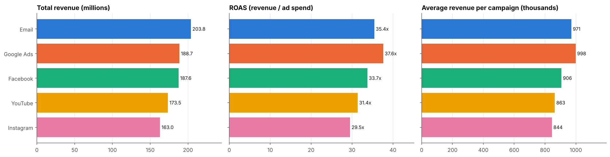
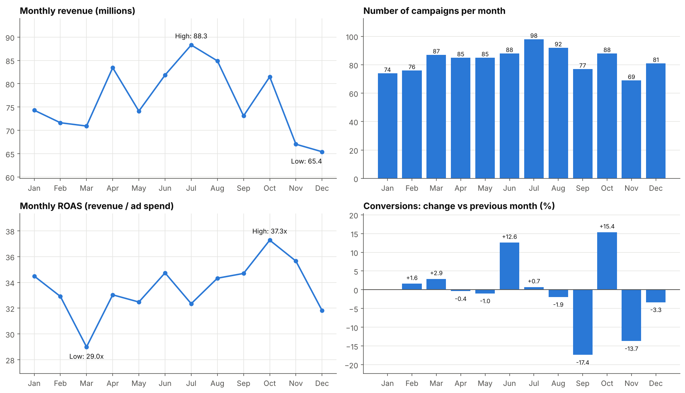
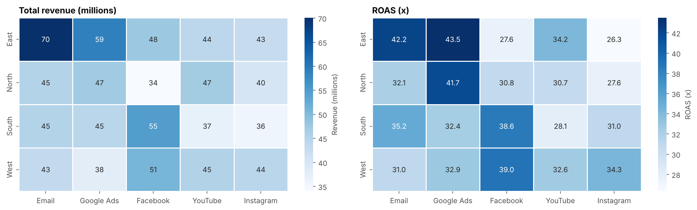
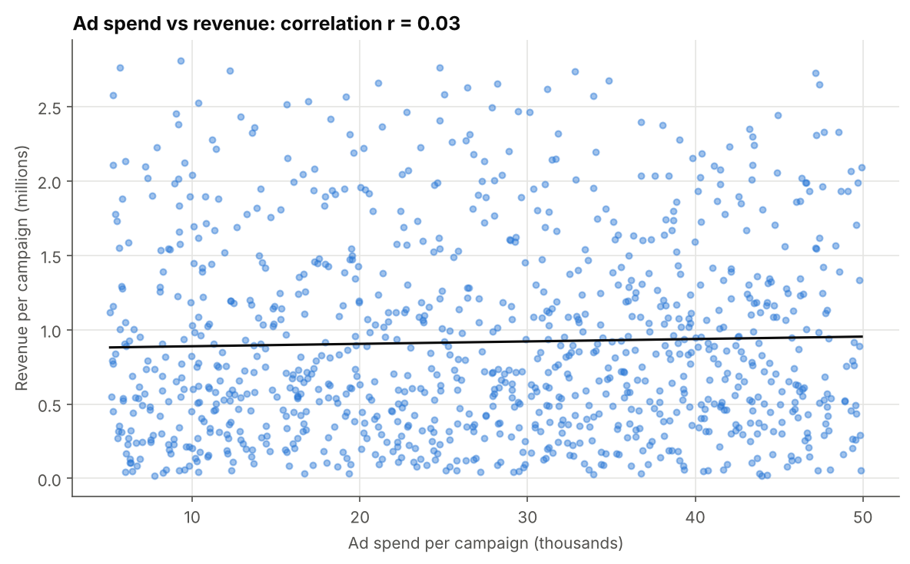

# ShopEase Marketing Data Analysis

Analysis of 1,000 marketing campaigns of an e-commerce company (ShopEase) to find which **channels, regions and months** perform best, and whether the differences are large enough to act on. Built with Python (Pandas, SciPy, Matplotlib, Seaborn) and exported to Excel.

## Business Questions
- Which channel generates the most revenue, and which gives the best return on ad spend (ROAS)?
- How do regions and months compare?
- Does a bigger ad budget go together with more revenue?

## Dataset
- **Source:** `Marketing Data Analysis.csv` from the [YBI Foundation project datasets](https://github.com/YBIFoundation/ProjectDataSet)
- **Size:** 1,000 campaign records, 1 Jan 2025 to 31 Dec 2025
- **Columns:** `Date, Channel, Region, Ad_Spend, Impressions, Clicks, Conversions, Revenue, CTR, Conversion_Rate`
- **Channels:** Email, Google Ads, Facebook, YouTube, Instagram | **Regions:** East, West, South, North
- No currency is stated in the dataset, so none is assumed here.

## Methodology
1. **Data checks:** no missing values, duplicates or zero/negative values. 59 rows (5.9%) have impossible funnel numbers (clicks above impressions, or conversions above clicks), so the stored CTR and Conversion_Rate are **not used**; conclusions rely on spend, revenue and conversions.
2. **Metrics:** ROAS = total revenue / total ad spend; cost per conversion = ad spend / conversions; average revenue per campaign (so channels with more campaigns are not unfairly favoured).
3. **Analysis:** channel, region, monthly trend (with month-over-month change in conversions) and region x channel heatmaps.
4. **Statistical tests:** Kruskal-Wallis tests to check whether the differences are real or just noise; Pearson correlation between ad spend and revenue.
5. **Excel export** of the summary tables.

## Results

| Channel | Campaigns | Revenue (M) | ROAS | Cost per conversion | Avg revenue per campaign |
|---|---|---|---|---|---|
| Email | 210 | 203.8 | 35.4x | 17.55 | 970,510 |
| Google Ads | 189 | 188.7 | 37.6x | 16.26 | 998,486 |
| Facebook | 207 | 187.6 | 33.7x | 18.09 | 906,214 |
| YouTube | 201 | 173.5 | 31.4x | 19.00 | 863,093 |
| Instagram | 193 | 163.0 | 29.5x | 19.32 | 844,425 |

Overall: about 916.6 million revenue from 27.4 million ad spend (ROAS 33.5x), 1.52 million conversions.






## Key Insights
- **Email has the highest total revenue, but mainly because it ran the most campaigns (210).** **Google Ads** earns the most per campaign, has the best ROAS (37.6x) and the lowest cost per conversion.
- **Instagram** is the weakest channel (ROAS 29.5x), followed by YouTube.
- Channel differences are **borderline significant** (p = 0.048 for revenue per campaign, p = 0.024 for ROAS).
- **East** has the highest total revenue (263.9M), again mostly because it ran the most campaigns (275). Regions do **not** differ significantly (p = 0.85 for revenue, p = 0.40 for ROAS).
- **July** has the highest revenue (88.3M) and the most campaigns (98); **October** has the best ROAS (37.3x). Months do not differ significantly, and conversions in the second half were only 1.3% lower than in the first.
- **Ad spend and revenue are not related** (r = 0.03), while revenue follows conversions (r = 0.79).

## Recommendations
1. Prioritise **Google Ads** and **Email**; review **Instagram** and **YouTube**.
2. Do not move budget between regions or months based on this data alone, since those differences are not significant.
3. Test budget changes in a controlled way before scaling, because spend does not predict revenue here.
4. Fix tracking of impressions, clicks and conversions so funnel rates can be trusted.

## Tech Stack
Python (Pandas, NumPy, SciPy) | Matplotlib, Seaborn | Excel (openpyxl) | Google Colab / Jupyter

## Repository Structure
```
Marketing-Data-Analysis/
├── notebook/
│   └── ShopEase_Marketing_Data_Analysis.ipynb
├── output/
│   ├── channel_performance.png
│   ├── region_performance.png
│   ├── monthly_trends.png
│   ├── region_channel_heatmaps.png
│   ├── spend_vs_revenue.png
│   └── shopease_summary.xlsx
└── README.md
```

## How to Run
1. Open `notebook/ShopEase_Marketing_Data_Analysis.ipynb` in Google Colab (the notebook loads the dataset directly from the YBI Foundation link).
2. Run all cells. Charts and the Excel summary are saved in `output/`.

## Limitations
- This looks like a **sample dataset**: a ROAS above 30x is far higher than real campaigns, and spend, impressions and clicks are unrelated. Treat the results as a practice analysis, not business advice.
- No currency or profit is given; ROAS measures revenue per unit of ad spend, not profit.
- The channel result is close to the 0.05 threshold and should be confirmed with more data.
- One year of data, one row per campaign, so seasonality cannot be separated from the number of campaigns run.

## Author
**Aakanksha Singh Sengar**: [GitHub](https://github.com/Aakanksha-sengar) | [LinkedIn](https://www.linkedin.com/in/aakanksha-singh-sengar-b254a1338)
